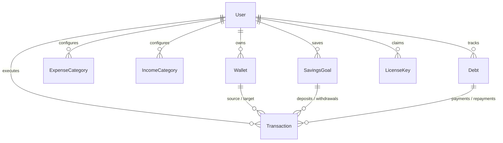

# Product Requirements Document (PRD) FinFlo

- **Nama Produk:** FinFlo (Smart Personal Finance & Budgeting)
- **Versi:** 1.0.0
- **Status:** Active / Production Ready
- **Platform:** Web Responsive (Desktop, Tablet, Mobile)
- **Basis Data:** PostgreSQL (Relasional) via Prisma ORM
- **Framework:** Next.js 14 (App Router) + TypeScript + Tailwind CSS

---

## 1. Ringkasan Eksekutif & Tujuan Produk

FinFlo adalah aplikasi manajemen keuangan pribadi dan perencanaan anggaran (*financial budgeting*) yang dirancang khusus untuk memenuhi kebiasaan finansial masyarakat Indonesia. FinFlo memadukan pencatatan kas multi-dompet (*multi-wallet*), pembagian alokasi anggaran berbasis metode teruji (*50/30/20* dan *6 Pilar Finansial*), pelacakan target tabungan impian, serta pengelolaan kewajiban modern seperti Paylater, Hutang, dan Piutang.

Aplikasi ini beroperasi tanpa bergantung pada klaim kecerdasan buatan (*non-AI*). Seluruh perhitungan, audit rasio, dan rekomendasi didasarkan pada rumus matematika keuangan deterministik, aturan akuntansi kas berpasangan, dan validasi data relasional yang transparan.

---

## 2. Arsitektur Sistem & Tumpukan Teknologi

### 2.1 Backend & Database
- **Runtime:** Node.js v20+ / v22 LTS
- **Database Server:** PostgreSQL 16+ / 17
- **ORM:** Prisma ORM v5.22
- **Arsitektur API:** Next.js 14 Route Handlers (`app/api/*`)
- **Koneksi Database:** Pola Singleton dengan penanganan pemulihan dinamis (*dynamic delegate proxy*) pada [lib/prisma.ts](file:///C:/DraGon/www/finflo/lib/prisma.ts) untuk stabilitas saat *hot-reload*.

### 2.2 Frontend & UI
- **Framework:** Next.js 14 App Router (`app/page.tsx`)
- **Bahasa:** TypeScript 5.7 (Strict Mode)
- **Styling:** Tailwind CSS 3.4 dengan dukungan penuh Dark Mode (class-based `dark`)
- **Ikonografi:** Lucide React
- **Visualisasi Grafik:** Chart.js 4.4 (Doughnut Chart & Bar Chart)

---

## 3. Skema Basis Data Relasional (Prisma Schema)

Struktur data FinFlo mengadopsi normalisasi relasional penuh di PostgreSQL melalui berkas [prisma/schema.prisma](file:///C:/DraGon/www/finflo/prisma/schema.prisma):

### 3.1 Model User (`User`)
Menyimpan identitas pengguna, hak akses paket (Free vs Pro), dan status verifikasi.
- `id` (String, PK, cuid)
- `name` (String)
- `email` (String, Unique, Index)
- `password` (String, Nullable, hashed with bcrypt)
- `avatar` (String, Nullable)
- `plan` (String, default: "free")
- `memberSince` (String, Nullable)
- `emailVerified` (DateTime, Nullable)
- Relasi: `wallets`, `expenseCategories`, `incomeCategories`, `transactions`, `debts`, `savingsGoals`, `licenseKeys`

### 3.2 Model Wallet (`Wallet`)
Menyimpan rekening bank, dompet digital, kantong tunai, atau akun investasi.
- `id` (String, PK, cuid)
- `name` (String, e.g. "BCA Utama", "GoPay", "Tunai")
- `type` (String: "cash" | "bank" | "ewallet" | "investment" | "savings")
- `balance` (Float, default: 0)
- `color` (String, default: "sky")
- `icon` (String, Nullable)
- `userId` (String, FK -> User.id, Cascade Delete)

### 3.3 Model ExpenseCategory (`ExpenseCategory`)
Menyimpan pos anggaran pengeluaran beserta alokasi persentase anggaran bulanan.
- `id` (String, PK, cuid)
- `name` (String, e.g. "Makan & Minum", "Nabung & Investasi")
- `icon` (String, Nullable)
- `color` (String, default: "#0ea5e9")
- `budgetPercentage` (Float, default: 0)
- `userId` (String, FK -> User.id, Cascade Delete)

### 3.4 Model IncomeCategory (`IncomeCategory`)
Menyimpan kategori sumber pendapatan.
- `id` (String, PK, cuid)
- `name` (String, e.g. "Gaji Pokok", "Freelance", "Bonus")
- `icon` (String, Nullable)
- `color` (String, default: "#10b981")
- `userId` (String, FK -> User.id, Cascade Delete)

### 3.5 Model Transaction (`Transaction`)
Pusat catatan arus kas mutasi keuangan.
- `id` (String, PK, cuid)
- `amount` (Float, nominal transaksi)
- `type` (String: "income" | "expense" | "transfer")
- `date` (String, format YYYY-MM-DD, Index)
- `category` (String)
- `description` (String, Nullable)
- `walletId` (String, FK -> Wallet.id, Cascade Delete)
- `toWalletId` (String, Nullable, FK -> Wallet.id, SetNull)
- `savingsGoalId` (String, Nullable, FK -> SavingsGoal.id, SetNull, Index)
- `debtId` (String, Nullable, FK -> Debt.id, SetNull, Index)
- `userId` (String, FK -> User.id, Cascade Delete, Index)

### 3.6 Model SavingsGoal (`SavingsGoal`)
Menyimpan target impian dan tabungan masa depan.
- `id` (String, PK, cuid)
- `title` (String, e.g. "Dana Darurat 6 Bulan")
- `targetAmount` (Float)
- `currentAmount` (Float, default: 0)
- `targetDate` (String, Nullable, format YYYY-MM-DD)
- `category` (String, Nullable)
- `color` (String, default: "#10b981")
- `userId` (String, FK -> User.id, Cascade Delete, Index)
- Relasi: `transactions`

### 3.7 Model Debt (`Debt`)
Menyimpan catatan hutang pinjaman, cicilan paylater, dan piutang.
- `id` (String, PK, cuid)
- `type` (String: "paylater" | "hutang" | "piutang")
- `title` (String, e.g. "Spaylater Sepatu", "Pinjaman Teman")
- `platform` (String, e.g. "ShopeePayLater", "Bank BCA", "Pribadi")
- `totalAmount` (Float)
- `remainingAmount` (Float)
- `minimumPayment` (Float, Nullable)
- `dueDate` (String, format YYYY-MM-DD, Index)
- `status` (String: "active" | "paid" | "unpaid", default: "active")
- `notes` (String, Nullable)
- `userId` (String, FK -> User.id, Cascade Delete, Index)
- Relasi: `transactions`

### 3.8 Model VerificationCode & LicenseKey
- `VerificationCode`: Otentikasi OTP pendaftaran dan reset password (kedaluwarsa 15 menit).
- `LicenseKey`: Aktivasi lisensi paket FinFlo Pro via kode aktivasi atau webhook pembayaran.

---

## 4. Alur Logika Bisnis & Aturan Akuntansi Keuangan

### 4.1 Manajemen Arus Kas & Saldo Dompet (Wallet Balance Rules)
1. **Transaksi Pengeluaran (`expense`):** Mengurangi saldo dompet asal secara instan (`balance = balance - amount`).
2. **Transaksi Pemasukan (`income`):** Menambah saldo dompet tujuan secara instan (`balance = balance + amount`).
3. **Transaksi Transfer Antar-Dompet (`transfer`):** Mengurangi saldo dompet asal dan menambah saldo dompet tujuan secara bersamaan dalam transaksi database atomik (`prisma.$transaction`).
4. **Penghapusan Transaksi (Rollback):** Ketika transaksi dihapus, dampak saldo dibalikkan secara otomatis ke keadaan semula.

### 4.2 Alur Alokasi Anggaran Bulanan (Budgeting & Health Score)
1. **Basis Anggaran Operasional:** Total anggaran bulanan dihitung murni dari pendapatan operasional bulan berjalan (`income` tidak termasuk transaksi internal seperti penarikan tabungan).
2. **Metode Alokasi Standar (6 Pilar Finansial FinFlo):**
   - Kos / Tempat Tinggal: 28%
   - Makan & Minum: 30%
   - Transportasi: 12%
   - Pulsa & Paket Data: 5%
   - Nabung & Investasi: 20%
   - Liburan, Nongkrong & Jajan: 5%
3. **Indikator Realisasi:**
   - Realisasi pos bulanan dihitung dari total transaksi pengeluaran kategori bersangkutan pada bulan kalender berjalan (`YYYY-MM`).
   - Warna indikator: Normal (Hijau/Teal), Mendekati batas (Kuning/Oranye pada >80%), Melebihi anggaran (Merah pada >100%).

### 4.3 Alur Target Impian (Savings Goals Lifecycle)
1. **Setor Tabungan (`POST /api/savings-goals/[id]/deposit`):**
   - Saldo dompet operasional berkurang (`expense`).
   - Saldo terkumpul target impian (`currentAmount`) bertambah.
   - Tercipta transaksi pengeluaran kategori `Nabung & Investasi` terikat ke `savingsGoalId`.
   - Realisasi pos *Nabung & Investasi* bulan berjalan meningkat.
2. **Tarik Dana Tabungan (`POST /api/savings-goals/[id]/withdraw`):**
   - Saldo target impian berkurang (`currentAmount`).
   - Saldo dompet penerima bertambah.
   - Tercipta transaksi pemasukan bertipe `income` dengan kategori `Tarik Tabungan`.
   - **Aturan Isolasi Anggaran:** Penarikan tabungan **tidak mengurangi** realisasi pos *Nabung & Investasi* bulan berjalan, dan **tidak dianggap sebagai pendapatan gaji baru** pada basis anggaran bulanan.
3. **Pembatalan / Hapus Transaksi Setor/Tarik:**
   - Jika transaksi setoran dihapus: saldo dompet dikembalikan, dan `currentAmount` target tabungan berkurang kembali.
   - Jika transaksi penarikan dihapus: saldo dompet ditarik kembali, dan `currentAmount` target tabungan bertambah kembali.

### 4.4 Alur Hutang, Piutang & Paylater Lifecycle
1. **Pencatatan Awal Fleksibel:**
   - **Piutang Baru:** Pengguna dapat memilih untuk langsung memotong saldo dompet sumber dana (`expense` ke kategori `Pinjaman & Piutang`), atau hanya mencatat kewajiban buku.
   - **Hutang Baru:** Pengguna dapat memilih untuk langsung menambahkan dana pinjaman ke dompet penerima (`income` kategori `Pencairan Pinjaman`), atau hanya mencatat kewajiban tagihan.
   - **Paylater Baru:** Dicatat sebagai kewajiban berjalan tanpa mutasi saldo kas awal.
2. **Pembayaran & Pelunasan Cicilan:**
   - **Paylater / Hutang:** Tombol *Bayar Cicilan* -> Saldo dompet berkurang (`expense`), kategori `Cicilan & Hutang`, sisa tagihan berkurang, status menjadi `paid` jika sisa nominal 0.
   - **Piutang:** Tombol *Terima Pembayaran* -> Saldo dompet bertambah (`income`), kategori `Pelunasan Piutang`, sisa piutang berkurang.
3. **Rollback Otomatis saat Transaksi Dihapus:**
   - Penghapusan transaksi pembayaran cicilan otomatis memulihkan `remainingAmount` pada tagihan dan mengembalikan statusnya ke `active`.

---

## 5. Matriks Batasan Fitur (Free Tier vs Pro Tier)

| Fitur / Modul | Free Tier | FinFlo Pro |
| :--- | :--- | :--- |
| **Batas Akun Dompet Aktif** | Maksimal 3 Dompet (Tunai, Bank, e-Wallet) | **Tanpa Batas** (Unlimited) |
| **Batas Kategori Pengeluaran** | Maksimal 8 Kategori | **Tanpa Batas** (Kustom bebas) |
| **Modul Hutang, Piutang & Paylater** | Pratinjau Terkunci (Modal Pembatas) | **Akses Penuh** |
| **Modul Rekomendasi Finansial** | Pratinjau Terkunci | **Akses Penuh** (Audit & Simulasi) |
| **Ekspor Laporan & Cetak PDF** | Terkunci | **Tersedia** (Unduh PDF & CSV) |
| **Sinkronisasi Cloud PostgreSQL** | Otomatis Tersinkronisasi | **Otomatis Tersinkronisasi** |
| **Metode Akses Pro** | N/A | Lisensi Seumur Hidup / Kode Lisensi |

---

## 6. Daftar Spesifikasi Endpoint API

| Metode | Jalur Endpoint | Deskripsi Fungsi |
| :--- | :--- | :--- |
| `POST` | `/api/auth/login` | Otentikasi pengguna, validasi password bcrypt |
| `POST` | `/api/auth/signup` | Pendaftaran akun baru dan pengiriman kode OTP |
| `POST` | `/api/auth/verify-code` | Validasi kode OTP 6-digit untuk verifikasi akun |
| `GET` | `/api/auth/me?email=...` | Hidrasi penuh seluruh entitas pengguna dari database |
| `POST` | `/api/auth/upgrade` | Aktivasi paket Pro via kode lisensi |
| `GET, POST` | `/api/wallets` | Ambil daftar dompet atau tambah dompet baru |
| `PUT, DELETE`| `/api/wallets/[id]` | Perbarui atau hapus dompet |
| `GET, POST` | `/api/categories` | Ambil atau tambah kategori anggaran |
| `PUT, DELETE`| `/api/categories/[id]` | Perbarui alokasi persentase atau hapus kategori |
| `GET, POST` | `/api/transactions` | Ambil riwayat atau catat transaksi baru |
| `PUT, DELETE`| `/api/transactions/[id]`| Edit transaksi atau hapus (dengan rollback otomatis) |
| `GET, POST` | `/api/savings-goals` | Ambil atau tambah target tabungan impian |
| `PUT, DELETE`| `/api/savings-goals/[id]` | Edit target atau hapus target impian |
| `POST` | `/api/savings-goals/[id]/deposit` | Setor dana ke target impian secara atomik |
| `POST` | `/api/savings-goals/[id]/withdraw`| Tarik dana dari target impian ke dompet |
| `GET, POST` | `/api/debts` | Ambil atau tambah hutang/piutang/paylater |
| `DELETE` | `/api/debts/[id]` | Hapus catatan hutang/piutang |
| `POST` | `/api/debts/[id]/pay` | Bayar cicilan atau terima pelunasan piutang |
| `POST` | `/api/sync` | Sinkronisasi / backup massal data lokal ke PostgreSQL |
| `POST` | `/api/webhooks/lynk` | Integrasi webhook payment gateway aktivasi lisensi |
